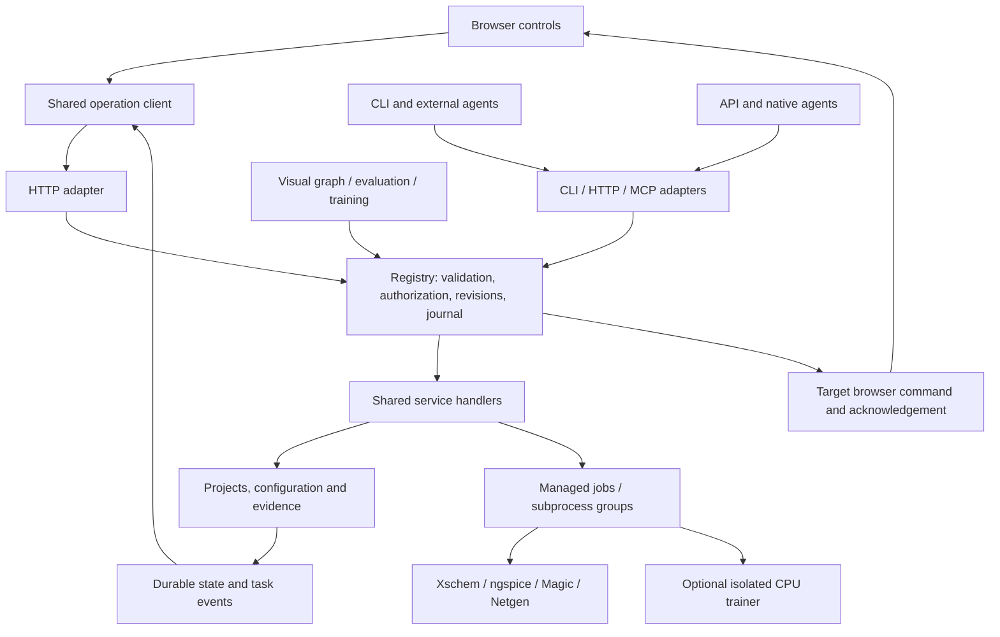

# Analog-factory architecture

The binding specification is [the project prompt](../analog-factory-project-prompt-en.md).
[Delivery status](status.md) and the [completion ledger](completion-plan.md) separate
implemented behavior, actual acceptance, and environment-dependent limits.

## Execution and state ownership

Python 3.12+ standard-library services and vanilla JavaScript remain the core stack.
Optional YAML parsing and ML dependencies do not affect manual design. One local
owner process serves each workspace; loopback is the default. Explicit trusted-LAN
binding is supported without adding a multi-user security model.

Every application action enters the operation registry. Its registration contains
schemas, permissions, confirmations, availability, effects and execution behavior.
HTTP compatibility routes, CLI, MCP, API assistants, graph nodes and training tools
adapt to these definitions. They do not contain separate business implementations.

Business state belongs to stores and managers on the server. State queries use the
same owners. Navigation, selections, geometry and unsaved drafts belong to a named
browser session. A frontend command is successful only after that live browser
executes and acknowledges it; disconnects and stale versions produce explicit
errors. Browser leases are ephemeral. Native editor drawing and PTY state belong
to the external process, with managed launch/cancel and narrowly scoped interfaces.

The private SQLite operation journal retains bounded replay/event/task metadata.
Claims are persisted before side effects; an interrupted ambiguous call returns
`OUTCOME_UNKNOWN`, not a second execution. Project revisions reject stale agent
or human writes. External editors cannot participate in the application's lock,
so their final filesystem check/write race remains a documented boundary.

## Modules and data

| Modules | Responsibility |
|---|---|
| `operations.py`, `operation_schema.py`, `operation_*.py` | Registration, validation, policy, discovery and transport adapters |
| `operation_journal.py`, `operation_sessions.py` | Durable invocation receipts and ephemeral acknowledged browser sessions |
| `projects.py`, `project_lifecycle.py`, `transfers.py` | Sources, history, trash, bounded ZIP import/export and artifact chunks |
| `service.py`, `execution.py`, `jobs.py`, `eda.py` | Shared use cases, snapshots, actual tools, process groups and evidence |
| `waveforms.py`, `simulation_batches.py` | Bounded waveform views, exact original-sample statistics and real scenario measurements |
| `workflow_graph.py`, `workflow_io.py`, `workflows.py` | v2 typed graphs, strict JSON/YAML interchange and compatible v1 tuning |
| `providers.py`, `provider_transport.py`, `agents.py`, `agent_scope.py` | Capability-driven protocols, streams and human-authorized bounded tool execution |
| `agent_cli.py`, `native_terminals.py` | Structured native CLI integration and human-only PTY fallback |
| `evaluation.py`, `training/` | Independent tasksets, real simulator rewards, baselines, replay and optional weight training |
| `static/` | Browser controllers using the shared operation client |

Project metadata stores stable identity, template, specifications, design source
roles and overrides. Native source files remain in `schematics/`, `layout/`,
`netlists/`, `testbenches/`, `workflows/`, and `reports/`. `.af/history/` holds
revisions; `.af/runs/<id>/` holds input snapshots and actual tool outputs. Run
records preserve argv, safe environment, versions, hashes, status, timing,
measurement definitions and provenance. Process success is distinct from DRC/LVS
success. Retries create separate records; source changes mark old results stale.

Archives preserve validated evidence while imported run/session/checkpoint records
remain inert. They cannot inherit PIDs, approved agent budgets or checkpoint
execution authority. Disk-backed transfers have size, count, expiry and ownership
limits. Chunk queries use immutable transfer ownership or artifact revision tokens
rather than repeatedly hashing the whole project. Text editing remains separately
bounded.

## Design, agent and training contracts

The packaged five-MOS SKY130 OTA template contains native design sources and no
saved passes. Explicit publication operations derive the schematic and extracted
netlists from verified local tool outputs. Magic extraction flattens hierarchy
while retaining top-level ports and capacitive parasitics. Distributed RC and
foundry signoff remain outside that qualified flow.

The v2 graph has typed data/control edges, branches, finite loop/retry budgets,
review/debug control, model calls and registered tool nodes. Four runnable examples
exercise actual simulation and verification. v1 scalar tuning remains compatible.

API transport support is declared per model; unknown streaming/image capabilities
are not assumed. Secret values remain in controlled server storage/environment,
never discovery/state/events. Automatic execution requires a private human-issued
scope with allowed operations/paths and finite budgets. Native terminals require
human authority and preserve the CLI's own approval interface; terminal bytes are
not durable journal entries.

Training executes in a pinned optional environment. Trusted tasksets and scoring
code own objectives/constraints, while the policy receives bounded observations
and action tools. Actual TRL GRPO updates LoRA weights, saves/reloads checkpoints,
and records token/action/EDA evidence and held-out comparisons. Weight updates do
not imply improved circuit design: the recorded full comparison did not improve
success rate. GPU frameworks and live cloud inference remain separate qualification
scopes. See [training](training.md) for measured resources and exact evidence.

## Maintaining the boundary

Define schemas and handler, register once, connect the shared UI client, generate
interfaces, and test real UI/agent behavior. The registry checker validates
metadata/handlers and scans declared frontend and engine boundaries. Lexical/AST
checks cannot prove arbitrary dynamic or third-party behavior; the generated
inventory and browser/EDA integration tests supplement them. See the
[operation development guide](operations/README.md).
