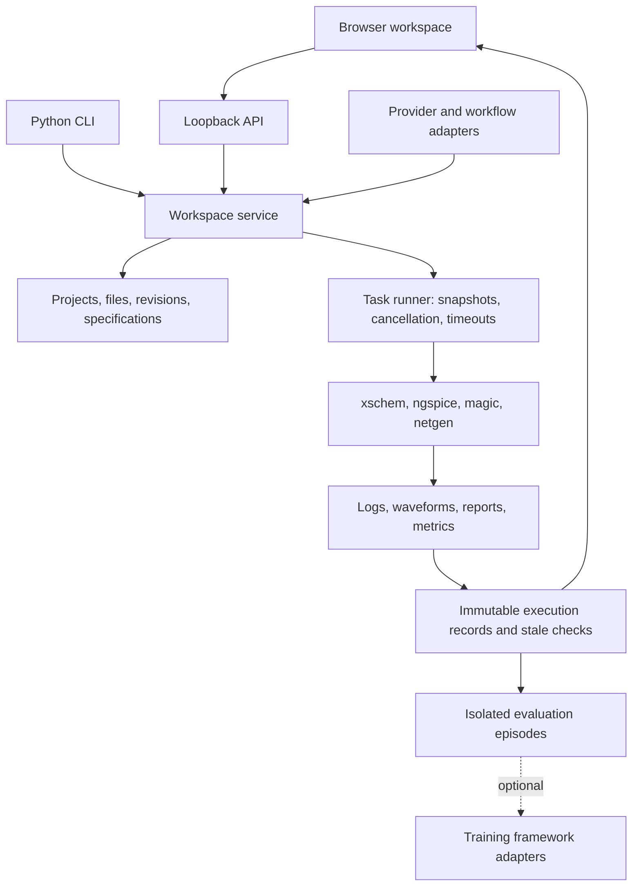

# Analog-factory architecture

The binding product specification is [the project prompt](../analog-factory-project-prompt-en.md).
This is an incremental implementation, not a claim that all five phases are accepted.

## Scope and defaults

Manual design takes precedence over AI. The workspace must operate without credentials,
GPU, or network. Manual actions, command-line actions, and workflows use identical task
adapters and run records. Only actual executions produce results; unavailable integrations
are explicitly unavailable. Ubuntu 24.04 LTS is the initial deployment target; validation
on the development host (Ubuntu 26.04 LTS) is recorded separately.

Use a Python 3.12+ modular monolith, standard-library HTTP server bound to loopback,
plain JavaScript/CSS workspace, and independent subprocess groups for EDA tasks.
This has no mandatory package installation and fits later Python training adapters.
Compared with Qt it avoids a core desktop runtime dependency; compared with Electron
it avoids a bundled browser and second process-management implementation. The browser
coordinates external xschem/magic windows. Embedding is deferred until desktop-specific
validation. The local server is a single-user application, not a public multi-user service.

## Repository and data contracts

- `analog_factory/projects.py`: validated project directories, source files, revision history.
- `analog_factory/execution.py`: task subprocesses, snapshots, manifests, cancellation/retry.
- `analog_factory/toolchain.py`, `eda.py`, `waveforms.py`: detection, commands, report parsing.
- `analog_factory/service.py`, `server.py`, `__main__.py`: shared use cases, HTTP, CLI.
- `analog_factory/workflows.py`: versioned graph validation and bounded real-simulation tuning.
- `analog_factory/providers.py`: explicit protocol adapters, selected context, no hidden credentials.
- `analog_factory/evaluation.py`: isolated episodes, independently calculated scores, baselines.
- `analog_factory/static/`: project tree, editor, waveform view, AI sidebar, run logs, settings.
- `examples/`: reproducible primitive-device amplifier and SKY130 starting assets.
- `tests/`: critical behavior and real ngspice integration tests; no mock signoff results.
- `docs/`: installation, evidence, integration matrix, phase status, limitations.

Project JSON carries schema version, id, name, template, specifications, and project tool/PDK
configuration. Design files live in `schematics/`, `netlists/`, `testbenches/`, `layout/`,
`workflows/`, and `reports/`. `.af/history/` stores content revisions; `.af/runs/<uuid>/`
contains a manifest, input snapshot, and output files. Metrics reference the run, source
log, definition, and conditions. Runs store argv, tool version, PDK identity, a safe
environment subset, start/end times, exit code, input/output SHA-256 hashes, timeout,
parent retry id, and status. Staleness is derived from current source hashes. Retries
never overwrite an old record. A process success is distinct from verification success.

Workflow JSON uses schema version 1, typed nodes and edges, bounded iterations/runtime,
and recorded run ids. Unsupported node execution fails clearly. Evaluation episodes use
private working copies and an evaluator-owned specification. Circuit optimization is
not described as model training. Training-framework readiness must never imply a trained
model or completed integration.

## Delivery and acceptance

0. Detect installed tools and prepared PDK assets; record versions and command probes.
   Validate GUI launch on a graphical host. Publish integration matrix and evidence.
1. Create/edit/archive projects, run real simulation and measurements, inspect waveforms,
   launch native tools, run DRC/LVS/extraction, compare pre/post results. Acceptance needs
   actual SKY130 schematic/layout and DRC/LVS reports; missing tools keep this gate open.
2. Configure one model protocol, test against configured endpoint, select context and
   record responses. CLI adapters use official noninteractive interfaces, explicit scope,
   and existing authentication. Live backend tests require the corresponding backend.
3. Save/reload a visual workflow and execute bounded parameter tuning with actual ngspice
   measurements and traceable iteration records. Unsupported graph nodes stay explicit.
4. Isolated evaluation and baseline comparison first. Framework-backed training acceptance
   requires trainable weights, saved checkpoints, token-level trajectories as applicable,
   held-out pre/post comparison, and evidence from real execution. No empty integration
   panel counts as completion.

## First end-to-end example

A resistor-loaded MOS common-source amplifier with an explicitly educational level-1
model runs without a PDK. DC operating point and transient measurements establish a
reproducible numerical baseline; a bounded resistor search targets output bias using the
same execution engine. This validates integration, not SKY130 device accuracy. A separate
SKY130 template references prepared PDK models and documents how to supply a matching
layout and validate DRC, LVS, extraction and post-layout results. Never invent extracted
parasitics or substitute a synthetic post-layout result for actual extraction.
