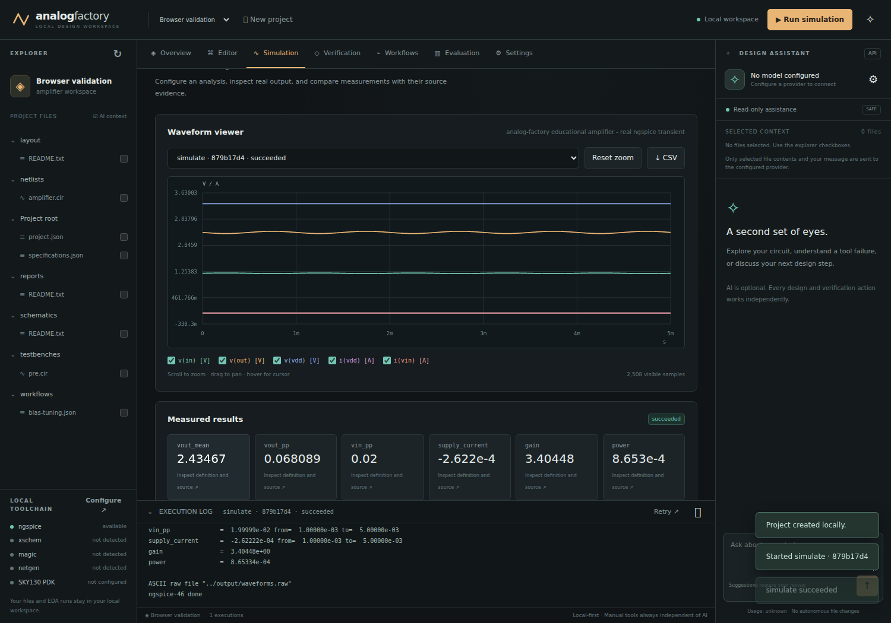

# Execution evidence

Validated **2026-09-30**. The [machine-readable record](validation.json) contains
host/tool identity, executable SHA-256, actual metrics, run IDs, source/artifact hashes,
tuning/evaluation records, and the local evidence archive path.

## Actual checks

| Check | Observed result |
|---|---|
| `python3 -m unittest discover -s tests` | **159 passed**, no skips; Codex reconnect regression run 41.456 seconds |
| `python3 -m compileall -q analog_factory scripts` | Passed |
| `node --check` for `app.js`, `agents.js`, `i18n.js` | Passed |
| Educational amplifier transient | ngspice 46 executed; 2,508 waveform samples; six measurements |
| OP, DC, AC, transient, noise forms | All five generated decks executed with actual waveform output |
| Scalar tuning | Six real simulations, target satisfied, original source unchanged |
| Random-search baseline | Three isolated real episodes, seed 42, evidence archived |
| Local HTTP API | Project/file operations and foreign-origin/Host rejection tested |
| Provider protocol | OpenAI-compatible and native Ollama history/tool calls tested against local HTTP fixtures; no real model inference claimed |
| Chromium desktop/mobile | Project creation, simulation, five measured traces, cursor/zoom, CSV, comparisons, file creation/save/history, workflow drag/save/load/run, evaluation/history, settings and stale warnings exercised; no JavaScript errors observed |

The suite tests actual subprocess/child termination, timeouts, fresh retries, cross-process
run/job observation and cancellation, stale external models, path/symlink protection,
credential endpoint scoping, malformed settings and missing measurements. Verification
parser fixtures are **not physical DRC/LVS acceptance evidence**.

The embedded-agent update adds durable session/project isolation, native CLI session
resumption, bounded JSONL parsing, process-group cancellation, permission enforcement,
approved/stale file edits, actual ngspice tool records, and late-response rejection.
The original manual browser smoke test was rerun in a temporary workspace: simulation,
revision history, six tuning iterations and two evaluation episodes passed, with no
JavaScript page errors and zero mobile overflow. The existing provider-settings browser
regression also passed. The agent browser regression passed session reload, approval,
backend switching, project isolation, cancellation races, full replacement review,
source refresh without draft loss, localization and mobile controls. CLI tests use
real subprocess fixtures, not authenticated
inference. The archived `validation.json` still describes the original educational
simulation evidence; the additional test counts above describe the current source.

A subsequent live Codex 0.159.2 connectivity check used the running application's
HTTP session/message API, existing CLI login, read-only mode, and no attached files.
The turn completed successfully with `OK`. This verifies basic embedded authenticated
inference, not CLI project edits or full EDA tasks. A separate direct CLI probe using
the server environment also returned `OK`. Three regression fixtures verify reconnect
notices followed by success, terminal failure, or missing completion. Intermediate
Codex `error` events must not terminate its native retry loop.

The sandbox initially prohibited localhost sockets. The HTTP tests passed with approved
local-network execution permission; none were skipped. Browser tooling and missing
browser libraries were installed/extracted only under `/tmp`. No system packages were
installed, and browser-test tooling is not a core runtime dependency.

## Measured educational example

| Measurement | Baseline result | Definition |
|---|---:|---|
| Output bias | 2.43467 V | Mean `v(out)`, transient 1–5 ms |
| Output amplitude | 0.0680892 V peak-to-peak | `PP v(out)`, transient 1–5 ms |
| Input amplitude | 0.0199999 V peak-to-peak | `PP v(in)`, transient 1–5 ms |
| Supply branch current | −0.000262222 A | Mean `i(VDD)`, SPICE voltage-source current convention |
| Absolute transient gain | 3.40448 V/V | Output/input peak-to-peak ratio; does not express phase |
| Supply power | 0.000865334 W | −3.3 × mean `i(VDD)` |

The 3.3 V level-1 MOS example starts with RD = 3,300 Ω. Bounded search over
1,000–10,000 Ω found **RD = 7,187.5 Ω**, producing **1.45067 V** mean output, within
the **1.5 V ± 0.05 V** target. This is circuit parameter optimization, not model training.
The three seeded random-baseline output means were 1.55835, 2.97544 and 2.38949 V;
none met the tolerance. Three samples on one task do not establish optimizer superiority.

The preserved validation project is `2043e510620c4b7e9ff8a05fef715671` under
`.validation/projects/`. Its archive is `.validation/2043e510620c4b7e9ff8a05fef715671.zip`.
Runtime directories are ignored by Git; regenerate on another checkout with
`python3 scripts/validate.py`. Records contain actual unique IDs and timestamps.



## Reproduce browser checks

`tests/browser-smoke.cjs` is an optional Playwright test that creates projects and
simulation runs in the selected local server. Start the server with isolated data,
provide Playwright in your development environment, install its Chromium runtime and
required system libraries, then run:

```bash
AF_URL=http://127.0.0.1:8765 node tests/browser-smoke.cjs
AF_URL=http://127.0.0.1:8765 node tests/browser-preferences.cjs
# Self-contained temporary workspaces; no existing server required:
node tests/browser-agents.cjs
node tests/browser-api-config.cjs
```

Set `AF_BROWSER_ARTIFACTS` to choose the screenshot directory. Playwright is not needed
to use the application or run the Python suite. The test never contacts a model provider.
The saved test also ran successfully against the local server at port 8876, reporting
five traces, six tuning iterations, two evaluation episodes and zero mobile overflow.

The interface-preferences update passes **67 Python tests**, including preference
validation, persistence, partial updates and preservation of tool/provider settings.
The preference browser check covers English/Chinese and light/dark switching,
reload and fresh-browser persistence, keyboard focus, unsaved form preservation,
failed-save rollback after navigating to another tab, unchanged source contents,
and mobile layout. Run it against a disposable workspace initially using English/dark.
The local Chinese font subset and its OFL license are included in the built wheel.

## Not validated

No xschem, Magic, LVS Netgen, prepared SKY130, graphical EDA desktop, live model API,
Claude session, full CLI task flow or training framework was configured for acceptance. No SKY130
DRC/LVS pass, physical extraction, post-layout result, trained checkpoint, held-out model
improvement or tapeout/signoff is claimed. See [delivery status](status.md) and
[integration matrix](integration-matrix.md) for remaining gates and upstream interfaces.
